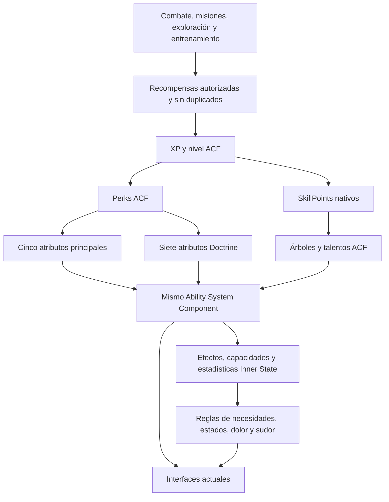

# Unificación de progresión ACF, Inner Doctrine e Inner State

Continuación con código y pruebas del piloto: [ProgressionPilot_20260924.md](ProgressionPilot_20260924.md). Las conclusiones de este documento describen la fase inicial de análisis.

Fecha local: 2026-09-24, America/Bogota. Evidencia técnica capturada también el 2026-09-25 UTC.

**Dictamen: viable y recomendable mediante una extensión propia de ACF/GAS. No está implementada ni validada una migración.** La recomendación es retirar la economía DXP/Meta, conservar ACF como dueño de XP/nivel/puntos y convertir Doctrine en atributos GAS adicionales. Las interfaces actuales pueden conservarse. No recomiendo reemplazar ACF, modificar su plugin ni sincronizar indefinidamente dos sistemas de progresión.

## 1. Alcance y evidencia

- Proyecto examinado: `D:/Projects UE5/NoShellForWinter`; motor `D:/Unreal Engine 5/Library/UE_5.8`; ACF Ultimate objetivo 4.3.5.
- Snapshot Git: `a99673ffbbef70d337b144f473869beb6215dcec` más el estado de trabajo registrado en `Saved/Analysis/ProgressionUnification/baseline.json`.
- El HUB y otros archivos tenían cambios anteriores. No se revirtieron, guardaron ni incorporaron a un commit.
- No se escribió ni hidrató `D:/Projects UE5/LustAsDeadlySin`. No se modificaron código de juego, configuración, assets, ACFU ni DazToUnreal.
- MCP nativo: `http://127.0.0.1:8000/mcp`. Inspección inicial de solo lectura; después una sesión PIE acotada, iniciada y detenida mediante `EditorAppToolset`.
- La guía histórica de supervivencia menciona SinfulAscension y restricciones de ACF binario. En este target el código relevante está en `Plugins/EFProjectSystems/Source/EFProjectSystemsGameplay/InnerDoctrine`, y la instalación actual expone headers públicos e implementaciones C++ de los módulos inspeccionados. La propuesta se basa en esos archivos actuales, no en los nombres históricos.

Los resultados brutos están en `Saved/Analysis/ProgressionUnification/`. El resumen persistente está en `Docs/Migration/Evidence/ProgressionUnification_20260924.json`. Las fuentes C++ son evidencia estática; no sustituyen probar las funciones en el binario cargado.

## 2. Qué existe realmente

| Área | Dueño actual | Evidencia y consecuencia |
|---|---|---|
| XP/nivel/puntos de atributos | `UARSLevelingComponent`, padre de `UACFGASStatisticsComponent` | Tiene `AddExp`, `GetCurrentLevel`, `GetCurrentExp`, `GetAvailablePerks`, `OnCharacterLevelUp` y serialización de nivel/XP/perks. Ya existe la base que interesa conservar. |
| Atributos principales | `UACFPrimaryAttributeSet` | Strength, Intelligence, Endurance, Constitution, Dexterity son atributos GAS. |
| Valores derivados | `UACFAttributeSet` y Gameplay Effects | Daños, defensas y crítico. Dependencias entre atributos mediante GE. |
| Estadísticas consumibles | `ACFStatisticsSetBP` | El ASC del Player ya registra este set junto al primario y al derivado. |
| Árbol de habilidades | `UACFSkillTreeComponent` | Tiene árboles, rangos por GUID, puntos, compra, requisitos de nivel/padres y respec. Su saldo `SkillPoints` es distinto de `Perks`. |
| Doctrine | `UProjectInnerDoctrineComponent` | Array propio de siete rangos, `CurrentRunDxp`, `MetaBankDxp`, compras propias y reglas de muerte. Además contiene pasivas, resistencias, maldición, hitos y modificaciones de combate. |
| Necesidades y sensaciones | `UProjectSurvivalNeedsComponent` | Arrays `Needs` y `Sensations`, máximos, consumo/recuperación y eventos. No son actualmente atributos GAS. |
| Estados | `UProjectSurvivalStatusComponent` | Activación, inmunidad y consecuencias de estados. Reglas propias que no desaparecen por usar GAS. |
| Penalizaciones al combate | `UProjectSurvivalAttributeBridgeComponent` | Ya conecta necesidades con seis atributos GAS: MeleeDamage, RangedDamage, SpellDamage, PhysicalDefense, SpellDefense, CritChance. |
| Entrenamiento | `UACFTrainingComponent` | Otra vía de mejora: acumula recompensas directas de atributos y las aplica como modificador ACF. No es solamente una fuente de DXP. |
| Sudor | `UDirtyPawnComponent` | Acumulación propia según actividad; `ProjectDirtyPawnEffectsBridgeComponent` comunica el estado Sweaty. |
| Combate propio | `UProjectCombatAttributeComponent` | Conserva valores propios y una ruta de daño que notifica a Doctrine. Debe distinguirse de la ruta de daño/muerte nativa de ACF. |

Lectura MCP del CDO `/Game/FullSample/Player.Default__Player_C:Statistic Component`:

- `CharacterLevel=1`.
- `LevelingType=EAssignPerksManually`.
- `PerksObtainedOnLevelUp=1`.
- Curva XP: `/AscentCombatFramework/Configuration/LevelingCurve.LevelingCurve`.
- Inicialización: fila `Player` de `ACF_SampleAttributesInit_DT`.
- `bAffectedByDifficultyLevel=false`.

El componente de habilidades heredado de `ACFUltimatePlayerBP` tiene dos árboles (`ACFPrimarySkills` y `ACFSecondarySkills`) y dos puntos iniciales. **Esos nombres no prueban que los atributos de Doctrine ya estén integrados.** En el CDO inspeccionado `bReplicates=false`, aunque el código del componente implementa propiedades replicables.

En el HUB, el pawn observado en PIE fue `BP_TSChar_C_0`, de `/Game/TattooShop/Blueprints/TSCharacter/BP_TSChar`. MCP confirmó que su padre es `/Game/FullSample/Player.Player_C`. Se encontraron juntos el ASC, estadísticas ACF, SkillTree, Doctrine, Needs, Status, SurvivalAttributeBridge y Training.

## 3. Por qué no basta con cambiar DXP por XP

En `ProjectInnerDoctrineComponent.cpp`:

- `GrantDxp` escribe un saldo independiente. `ReasonId` no actúa como deduplicador: se descarta.
- `SpendDxpOnAttribute` descuenta DXP y modifica el array de rangos.
- El coste es `round(80 * (rango + 1)^1.35)`; no equivale a un punto nativo.
- `NotifyDamageDealt` concede por defecto 3 DXP por impacto válido y 15 adicionales por muerte en esa ruta de combate.
- `HandleRunDeath` reinicia los rangos y traslada al banco una fracción del saldo no gastado: por defecto 10%, o todo el saldo con Mastery.
- `ProjectInnerDoctrineSaveGame` guarda Meta y Mastery. No guarda los rangos ni el saldo de la run. El TravelState inspeccionado conserva Curse, no la progresión de Doctrine.
- Charisma modifica determinadas fuentes de DXP; los backgrounds conceden niveles iniciales y multiplicadores por afinidad.

ACF concede XP por muerte en `UACFDamageHandlerComponent::HandleStatReachedZero`. Sustituir ciegamente `GrantDxp` por `AddExp` puede pagar dos veces una muerte. Tampoco deben traducirse todos los impactos a XP sin valorar farmeo y reparto de recompensa. Hay que inventariar las rutas Blueprint además de los callers C++ antes de cortar las rutas antiguas.

El entrenamiento añade recompensas permanentes mediante `AccumulatedAttributeRewards` y un GE. Si la intención es que toda mejora se origine en XP y nivel, su recompensa ordinaria debe pasar al mismo canal de XP. Mantener premios directos puede ser una decisión válida, pero sería una excepción explícita, no una segunda economía oculta.

## 4. Alternativas evaluadas

| Alternativa | Ventaja | Coste o problema | Valoración |
|---|---|---|---|
| Sincronizar DXP y XP en ambos sentidos | Cambio inicial reducido | Dos saldos, dos reglas de gasto, guardados y bucles; no cumple el objetivo de mantenimiento | Descartar como solución final |
| XP ACF con rangos Doctrine todavía propios | Permite una transición corta | Los rangos siguen fuera de GAS y equipos/efectos necesitan adaptaciones | Útil solamente como etapa |
| ACF + AttributeSets propios en el mismo ASC | Reutiliza niveles, perks, efectos, atributos, tablas y eventos; conserva UI | Migración de persistencia y de lectores/escritores | **Recomendada** |
| Convertir los siete atributos en nodos del SkillTree | Reutiliza compras/rangos/respec | Confunde identidad de atributo con habilidad; la integración de efectos por rango y requisitos necesita pruebas | Útil para talentos, no como representación única de todos los atributos |
| Willpower/Cunning totalmente derivados de los cinco principales | Máxima sencillez de fórmulas | Elimina la elección independiente y cambia el significado de la pantalla de mejora | No preserva el diseño actual |
| Nuevo sistema propio o GAS separado | Libertad total | Se pierde la ventaja de ACF y aumenta mantenimiento | Contrario a la prioridad del proyecto |

La categoría visual “atributos secundarios” no obliga a convertirlos en estadísticas derivadas. En la terminología de ACF, lo secundario suele ser daño/defensa generado desde atributos. Doctrine puede mostrarse como grupo secundario y seguir siendo **atributos invertibles independientes dentro de GAS**.

## 5. Arquitectura recomendada

### Progresión

Usar el componente de estadísticas existente. No añadir otro `UARSLevelingComponent`, ASC, contador de nivel ni curva paralela. Los eventos propios conceden XP mediante una fachada de proyecto que llama la API pública de ACF. Los eventos nativos que ya conceden XP conservan un único responsable de la recompensa.

Proponer un adaptador acotado dentro de EFProjectSystems, sin crear un framework genérico adicional. Sus responsabilidades: validar concesiones/compras, impedir duplicados, aplicar límites, actualizar la UI y conectar el evento de nivel con los puntos del árbol. Debe leer XP/nivel/puntos nativos, no mantener una copia autoritativa.

**Recomendación de monedas:** una XP, un nivel y la separación nativa entre puntos de atributos y de habilidades. Los mismos `Perks` mejoran Strength o Willpower. Los talentos usan `SkillPoints`, obtenidos del mismo nivel mediante una regla configurable. Dos clases de puntos con un mismo origen no implican dos progresiones.

Si se exige además un solo saldo para atributos y talentos, la viabilidad continúa, pero aumenta el trabajo: la compra y el respec del árbol descuentan/reembolsan su propio `SkillPoints`. Habría que adaptar esas operaciones de forma transaccional y evitar compras que eludan la validación. No recomiendo mantener dos saldos continuamente igualados ni recompensar dos veces un mismo nivel.

Hay un ajuste de balance inevitable: la configuración actual concede un perk por nivel. Entre los niveles 1 y 100 serían 99 puntos nuevos para repartir, ahora entre doce atributos en lugar de cinco. Mantener sin más el cap 100 de cada atributo Doctrine y todos sus hitos no conserva el ritmo anterior. Revisar puntos por nivel, límites y umbrales de talento conjuntamente; no crear XP secundaria para resolver esa escasez. La tabla aritmética de costes antiguos en la evidencia es una referencia, no una tasa de conversión.

`OnCharacterLevelUp` puede emitirse también en replicación. La recompensa debe concederse en autoridad y recordar el último nivel recompensado por personaje; cargar, reconectar o reaplicar una instantánea no debe crear puntos. Probar también una concesión que sube varios niveles de una vez.

Verificar los bordes reales de la API instalada: `Internal_AddExp` usa un límite literal de nivel 255, mientras el settings leído indica `MaxLevel=100`; una curva ausente devuelve -1. No suponer que el settings por sí solo impone el límite. La validación debe incluir curvas válidas, XP positiva, overflow y todas las fuentes nativas que llegan a AddExp.

### Atributos Doctrine

Crear un `UEFDoctrineAttributeSet` propio, derivado de `UAttributeSet` o del `UACFBaseAttributeSet` público después de verificar sus clamps. Registrar **una sola instancia de esa clase en el ASC existente**. No duplicar los cinco atributos oficiales ni reemplazar `UACFPrimaryAttributeSet`.

Campos: Willpower, Offensive, Defensive, Faith, Cunning, Celerity, Charisma. El código instalado de `AssignPerkToAttribute(FGameplayAttribute, int32)` no restringe la compra al set primario: aumenta el valor base del atributo y consume perks. Esto fundamenta técnicamente la integración, pero la compra de un atributo nuevo sigue requiriendo un prototipo compilado.

Separar siempre:

- Rango invertido o permanente: utilizado para gasto, límites, refund y desbloqueos permanentes.
- Valor efectivo GAS: incluye equipo, estados y bonificaciones; utilizado para sinergias temporales.
- Talento aprendido: lo decide la progresión; no debe aparecer permanentemente por equipar y quitar un objeto.

Los clamps GAS no sustituyen una validación de compra: no consumir puntos si el atributo está al máximo, no aceptar cantidades negativas, validar que el set esté registrado y que el atributo pertenezca al catálogo comprable. Las funciones nativas inspeccionadas no cubren por sí solas todas esas condiciones.

`GetAttributeLevel` y los snapshots actuales pueden mantenerse como API de compatibilidad, delegando en GAS. Retirar gradualmente la escritura del array antiguo. Una caché para UI puede existir, pero nunca otro dueño de los rangos.

### Necesidades, sensaciones y estados

En el resultado final, trasladar los números de Hunger/Thirst/Sleep/Madness/Pain/Curse al mismo ASC mediante un set propio, por ejemplo `UEFInnerStateAttributeSet`, con máximos y tasas cuando tenga sentido. Así los efectos y atributos ACF pueden afectarlos directamente.

Conservar los componentes actuales para reglas como consumo, sueño, blackout, derrotas, inmunidades y transiciones. GAS aporta almacenamiento, modificadores y eventos; no conoce automáticamente qué significa hambre o desmayo.

Cambiar por etapas los getters/setters de `UProjectSurvivalNeedsComponent` para utilizar GAS, manteniendo el contrato de snapshots y eventos. **No dejar dos simulaciones consumiendo hambre, ni dos regeneraciones de Pain, ni una sincronización bidireccional cada tick.** El componente actual debe dejar de escribir en su antiguo almacenamiento cuando se cambie de dueño.

Mantener el catálogo de estados como autoridad de sus reglas durante la transición. Publicar tags GAS y aplicar/remover efectos por fuente para interoperabilidad. Evitar dos máquinas de estados independientes para Fear, Sweaty o Cursed. Los tiempos, fuentes de inmunidad y episodios no se reducen a un booleano GAS.

El puente actual aplica diferencias aditivas y deduce un baseline a partir del valor efectivo. A largo plazo, penalizaciones y bonificaciones temporales deberían usar GE con handles y fuentes identificables. Retirar el puente anterior al activar esos efectos: de lo contrario se penaliza dos veces. Probar equipo, regeneración, cambio de máximo y retirada de efectos en distinto orden.

Sudor puede conservar inicialmente `DirtyPawnRuntime` como dueño de su simulación y materiales. Hacer que su tasa consulte un parámetro calculado desde Endurance. Solo trasladar su acumulador a GAS si existe una necesidad concreta de efectos o replicación; unificar progresión no exige rehacer el render de DirtyPawn.

### Árboles y hitos

Usar `UACFSkillTreeComponent` para las habilidades comprables y ramas futuras, con assets de proyecto. El formato de grafo no obliga a adoptar sus widgets: la lista de Doctrine puede mostrar los mismos datos con su diseño actual.

Conservar el significado de los hitos actuales de rango 5/10 durante la primera migración. Convertirlos automáticamente en compras de pago cambiaría el balance. Primero portar sus efectos manteniendo desbloqueo por rango; después representar los talentos en el catálogo/árbol común, con una política explícita de desbloqueo gratuito o inversión.

**Límite comprobado:** `CanUnlockSkill` valida nivel de personaje, puntos, padres y rango máximo. No ofrece en esa implementación una lista genérica de requisitos como `Willpower >= 5`. Una condición adicional requiere adaptación propia y que todas las entradas de compra la respeten, o una representación equivalente mediante padres. No afirmar que basta con rellenar una casilla nativa.

**Otro límite:** la ruta de mejora elimina y reaplica el GE sin pasar explícitamente el nuevo rango al helper usado. No dar por hecho que el efecto escala solo porque sube `SkillLevels`. Preferir nodos de rango único para el primer prototipo y probar los multirrango antes de apoyarse en ellos.

## 6. Sinergias concretas sin tocar la presentación

| Cruce | Diseño propuesto | Integración existente que se conserva |
|---|---|---|
| Constitution + Willpower → Pain | Constitution aumenta tolerancia física; Willpower mantiene su aportación a capacidad mental/corporal. Preferir inicialmente actuar sobre PainMax para conservar el cálculo de dolor recibido. | El knockout ya consulta el máximo de Pain y existe la presentación normalizada. |
| Endurance → sudor por esfuerzo | Reduce la tasa de acumulación por correr/saltar/rodar con un mínimo. No reduce automáticamente toda suciedad ni modifica materiales. | `SweatMovementGainPerSecond`, `UpdateSweatState` y el puente Sweaty. |
| Intelligence + Cunning → lockpicking | Intelligence ayuda a analizar la cerradura; Cunning conserva control/precisión. Contribución menor de Intelligence, saturación y dificultad preservadas. | `ComputeSpeedMultiplier`, `ComputeTargetHalfRange` y sus curvas decrecientes de Cunning. |
| Faith + Willpower → maldición/madness | Composición de resistencia y recuperación; Curse conserva su máximo fijo si se preserva el contrato actual. | Resistencias e inmunidades existentes de Doctrine. |
| Charisma → recompensas sociales | Bonificación a XP de diálogo/misión autorizada, sin crear una moneda ni aumentar indiscriminadamente XP de combate. | Semántica actual de fuentes y límite configurable. |
| Strength + Offensive / Constitution + Defensive | Diferenciar crecimiento básico de combate de especialización; verificar una sola aplicación de daño/mitigación. | Rutas de daño propia y ACF, que deben converger antes de sumar nuevos GE equivalentes. |

Ejemplo ilustrativo de balance, **no implementado ni aprobado como balance final**:

- `C = max(0, Constitution - ConstitutionInicial)`; `PainMax = 100 * (1 + 0.015 * Willpower) + 1.5 * C` conserva el coeficiente base actual de Willpower y añade Constitución. Usar las definiciones reales de máximos si están configuradas, no reemplazarlas por esta constante.
- `E = max(0, Endurance - EnduranceInicial)`; `TasaSudorEsfuerzo = TasaBase * clamp(1 / (1 + 0.025 * E), 0.5, 1)`.
- Lockpicking puede usar Cunning en la ventana de acierto e Intelligence en una reducción adicional pequeña de velocidad; evitar que ambos multipliquen sin límite la misma mejora.

Estas fórmulas se ajustarían en curvas/tablas de proyecto, no distribuidas entre widgets. Distinguir atributos iniciales de bonificaciones evita que los valores iniciales ACF, normalmente mayores que cero, hagan irrelevante un Doctrine que empieza en cero.

Al cambiar máximos, preservar la política actual: las necesidades conservan proporción; las sensaciones conservan puntos absolutos con clamp donde corresponde. No regalar curación/comida ni provocar derrotas artificiales al equipar o retirar un bonus. Evitar ciclos: penalizar Endurance por hambre y hacer que Endurance reduzca hambre puede crear una realimentación indeseada.

## 7. Conservación visual

Mantener los widgets/clases, materiales, tipografías, iconos, orden, tamaños, navegación y teclas actuales. Cambiar proveedores de datos y comandos, no reconstruir la UI.

Superficies localizadas:

- `ProjectInnerDoctrineAttributesPanelWidget`: recibe rangos y saldos; contiene los textos DXP/META.
- `ProjectInnerDoctrineExchangeMenuWidget` y filas: conservan lista, selección y descripción; el coste pasa a puntos y el requisito a la progresión común.
- `ProjectInnerDoctrineMenuSubsystem`: actualmente llama `SpendDxpOnAttribute` y `WithdrawMetaDxp`; debe dirigir las compras al adaptador único.
- `ProjectSurvivalNeedsWidget`, `ProjectSurvivalStatusWidget` y `ProjectRealtimeSnapshotComponent`: mantener los snapshots y el formato de barras/porcentajes.
- ActivityFeed, backgrounds, altares y textos de ayuda: retirar menciones engañosas a DXP/Meta y actualizar eventos.

En el panel compacto de coma, retirar DXP/META según lo solicitado. En el menú de inversión, reutilizar ese espacio para nivel y puntos de atributos disponibles, con el mismo estilo. La pantalla ACF muestra su grupo principal y Doctrine muestra su grupo secundario, pero comprar en cualquiera consume el mismo saldo de atributos y actualiza la otra.

Se puede conservar el aspecto, aunque los costes y las reglas de persistencia cambian necesariamente si se elimina DXP. Preservar apariencia no equivale a mantener una economía que se está sustituyendo. La paridad visual final sigue **PENDING** hasta disponer de capturas comparables antes/después a la misma resolución y estado.

## 8. Guardado y muerte: decisiones que hay que cerrar

Recomendación inicial: conservar nivel, XP, inversión en atributos y talentos por personaje; resetear únicamente los recursos/estados que indique la derrota. Es la opción más simple sin Meta. Si se desea perder progreso de run, representarlo como una política del único sistema ACF, no recrear una segunda progresión por debajo.

Para partidas existentes:

1. Versionar la migración y conservar intacto el archivo antiguo como respaldo.
2. Definir propiedad por personaje/slot. El banco antiguo usa un slot propio y no debe importarse de nuevo para cada personaje o carga.
3. Leer solo información realmente guardada. Los rangos transitorios no se pueden reconstruir desde un archivo que contiene únicamente Meta y Mastery.
4. Convertir el DXP existente mediante una política explícita. No hay equivalencia justificada 1:1 entre DXP y XP ni entre coste 80 y un perk.
5. Evitar compensar simultáneamente rangos migrados y todo su coste gastado: produciría una doble recompensa.
6. No usar `GetTotalExpsAcquired()` como contador histórico sin pruebas: en el código instalado su cálculo no equivale de forma evidente a sumar toda la experiencia de niveles anteriores.
7. Guardar el marcador de importación y los resultados conjuntamente. Una segunda ejecución debe ser un no-op; contemplar interrupción a mitad de migración.
8. Restaurar atributos base y rangos; reaplicar equipo, talentos y estados una sola vez. No serializar sus valores efectivos como base.

ACF serializa atributos enumerados en `SerializableAttributes`: crear una tabla propia que conserve todas las entradas oficiales requeridas y añada los atributos nuevos. Los mappings de tags/set-by-caller, inicialización y serialización deben mantenerse en assets del proyecto y compararse al actualizar ACF.

`AACFCharacter::GetComponentsToSave_Implementation` devuelve en C++ estadísticas, daño y equipo. Hay que revisar cualquier override Blueprint y registrar explícitamente SkillTree/estado de proyecto/Training cuando proceda. Las líneas antiguas `ComponentsToBeSaved` de `DefaultPlugins.ini` no son una garantía: el header actual de `UALSSaveGameSettings` no declara esa propiedad.

La documentación del árbol promete persistencia, pero la prueba real debe incluir que sus GE/abilities vuelvan después de cargar. Tener `SaveGame` en rangos/puntos no demuestra por sí solo que los handles y efectos estén restaurados.

## 9. Mantenimiento con Codex y futuras actualizaciones

Mantener el código de integración en EFProjectSystems y los assets nuevos en `/Game/_Game/Data/Progression`. No renombrar de entrada InnerDoctrine ni sus clases públicas: preservar los contratos reduce referencias rotas y redirects innecesarios.

Un catálogo editable debe relacionar ID/tag estable, atributo GAS, grupo de UI, límites, coste, textos y reglas. Curvas y tablas para números; componentes especializados para comportamiento. Añadir un talento o una fórmula no debería exigir tocar ambos widgets.

Añadir un atributo GAS nuevo sí puede requerir C++/UHT: no prometer extensibilidad ilimitada por JSON. Lo que debe ser sencillo por datos es ajustar atributos existentes, recompensas, costes, conexiones, descripciones y efectos configurables.

Encapsular las APIs de ACF usadas en un adaptador pequeño y probado. Usar headers públicos y tipos directos en esta versión; reservar reflexión para compatibilidad justificada. No introducir dependencias de runtime con UBG, Python editor o MCP.

Al actualizar ACF: verificar contratos de compra/level-up/save, comparar tablas oficiales con las extensiones del proyecto y ejecutar regresiones. No es realista prometer cero trabajo para futuras versiones; sí evitar un fork de Marketplace y localizar ese trabajo.

## 10. Pruebas realizadas y límites

| Comprobación | Resultado | Evidencia |
|---|---|---|
| Editor target y MCP nativo | PASS, inspección | `baseline.json`, CDO y mapa HUB leídos. |
| ACF manual leveling y ASC actual | PASS, configuración | Nivel inicial 1, un perk/nivel, tres sets iniciales. No prueba de concesión de XP nueva. |
| Doctrine/Needs/SkillTree/Training juntos en PIE | PASS, presencia | `runtime.json`, pawn BP_TSChar hijo del Player. |
| Puente de necesidades a GAS | PASS, inicialización | `baseline_pie.log`: `Ready=true`, `Resolved=6/6`. No prueba exhaustiva de penalizaciones ni orden de equipos. |
| Necesidades funcionando | PASS, lectura puntual | En PIE Hunger/Thirst/Sleep ya habían descendido; Madness/Pain/Curse en cero. No ensayo controlado de tasas. |
| Captura de la sesión | PASS, captura revisada | `baseline_pie.png`: juego y HUD ACF visibles, nivel 1 y XP 0/100. Menús de coma/Doctrine no se abrieron en esta captura. |
| Hashes de archivos observados antes/después | PASS, alcance limitado | 403 archivos, cero cambios; ningún archivo nuevo en SaveGames. Incluye Player, HUB, contenido Daz observado y archivos Frederick encontrados por nombre. No es un gate completo de todos los archivos de plugins protegidos. |
| Finalización de PIE | PASS | `IsPIERunning=false` después de `StopPIE`. Editor permanece abierto. |
| Curvas nativas durante PIE | PENDING investigación | Warnings de `FScalableFloat` sin CurveTable/DataRegistry para StrengthToMeleeDamage, EnduranceToMaxStamina y ConstitutionToMaxHealth. No atribuir automáticamente todos al Player ni afirmar que las fórmulas están rotas sin aislar el actor. |
| Concesión única de XP y compra Doctrine vía perks | PENDING | No existe todavía el AttributeSet/adaptador propuesto. |
| Enlace nivel → SkillPoints | PENDING | No hay enlace en el C++ inspeccionado del árbol; búsqueda acotada en gráficos de Player/UltimatePlayer/BP_TSChar sin coincidencias. No se declara ausencia global en todos los assets. |
| Tests Automation existentes | PENDING ejecución | Se inspeccionaron 14 tests InnerDoctrine, incluyendo compras, rangos, máximos, inmunidades y Cunning. No se ejecutaron. |
| Build, compile Blueprint, cook y packaged de la unificación | PENDING | No se realizó implementación. Esta auditoría no certifica una migración. |
| Paridad visual completa y guardado/carga/respec | PENDING | Requiere prototipo e integración, además de capturas comparables. |

Limitaciones de herramientas: Computer Use no pudo conectar con su pipe nativo tras recuperación; UECP respondió `License verification required` al pedir documentación de herramientas. No se eludió esa restricción. MCP nativo permitió completar la inspección y PIE; no ofrece aquí un ejecutor general de UFunctions privadas para las pruebas transaccionales. Estas limitaciones no convierten resultados estáticos en pruebas de runtime.

## 11. Orden de implementación recomendado

1. **Contrato y baseline:** política de muerte/partida, economía de puntos, tabla de recompensas, pruebas de las curvas existentes, inventario de lectores/escritores/BluePrints y referencias. Resolver las advertencias relevantes antes de equilibrar nuevas sinergias.
2. **Prototipo vertical mínimo:** un atributo Doctrine en un set propio del mismo ASC; compra con perks ACF; ambos menús leen ese saldo; conservar estilo; guardar/cargar sin duplicados. Verificar registro temprano del set e inicialización antes de snapshots.
3. **Corte de la economía DXP:** siete atributos, callers antiguos adaptados, migración versionada, XP única, entrenamiento/backgrounds/feed/altares y muerte. No dejar el backend DXP activo a la vez que el nuevo.
4. **Inner State y efectos:** mover números a GAS por grupos, mantener API visual, sustituir penalizaciones por GE cuando se retire el puente correspondiente; añadir primero una sinergia de dolor, luego sudor y lockpicking.
5. **Talentos y árbol común:** conservar hitos automáticos, introducir ramas nativas, conectar puntos al nivel sin duplicar, verificar requisitos, efectos por rango, respec y carga. Replicación solamente PASS tras probarla, incluyendo `bReplicates` del componente.
6. **Validación de entrega:** build mediante wrapper de UE 5.8/Daz; compile de los Blueprint afectados; PIE con UI real; capturas; cook; juego empaquetado; invariantes completas y commit pequeño por fase. Los gates no ejecutados permanecen PENDING.

Casos de aceptación obligatorios: XP por muerte una sola vez; varios niveles en una concesión; gasto de un perk desde cualquiera de los menús reflejado en ambos; compra rechazada al máximo sin cobro; quitar un equipo sin perder rango comprado; efectos aplicados exactamente una vez tras carga; respec con refund correcto; necesidades sin doble decay; dolor con el mismo criterio de knockout; sudor más lento conservando materiales; lockpicking con misma interacción visual; viaje/respawn/nueva partida sin copiar progreso a otro personaje; migración ejecutada dos veces sin crear XP; mantenimiento de O, Period, L, Comma, N, C, Y, J, H y T/Plus/Minus.

## 12. Documentación externa contrastada

Consulta realizada el 2026-09-24 local. Se usaron fuentes primarias. SlimWiki entrega parte del contenido en datos de render de Next.js; se extrajo el texto público de la misma página cuando el navegador de consulta solo devolvía el encabezado. Copias de trabajo en `Saved/Analysis/ProgressionUnification/official_*.txt`.

- [ACF: sistema de niveles](https://slimwiki.com/dark-tower-int/acfu/new-v4-leveling-system-rndzepscsg-smpqq4ufoqtq): XP, nivel, perks y modalidades manual/curvas.
- [ACF: estadísticas GAS](https://slimwiki.com/dark-tower-int/acfu/new-v4-acf-gas-statistics-component-jwy5svt9db-k3c8pyltl4ly): separación entre atributos, derivados y estadísticas, y dependencias mediante GE.
- [ACF: modificadores](https://slimwiki.com/dark-tower-int/acfu/new-v4-acf-attributes-modifiers-7soz28ddbs-p0x7lvd98zk7): modificadores persistentes y mappings set-by-caller.
- [ACF: Skill Tree, experimental V4.2](https://slimwiki.com/dark-tower-int/acfu/skill-tree-creator-experimental-v42-keu5sxzb66-ja6mablk1fal): árboles/rangos/puntos, API y configuración. Sus promesas generales no sustituyen probar el target 4.3.5.
- [Epic: Gameplay Attributes y Attribute Sets, UE 5.8](https://dev.epicgames.com/documentation/en-us/unreal-engine/gameplay-attributes-and-attribute-sets-for-the-gameplay-ability-system-in-unreal-engine): atributos base/efectivos y coexistencia de sets de clases distintas en un mismo ASC.

La propuesta arquitectónica es una inferencia a partir del código y la configuración observados. Las fórmulas y la política de persistencia son recomendaciones de diseño. La viabilidad no equivale a una certificación de que todos los sistemas ya están unificados.
